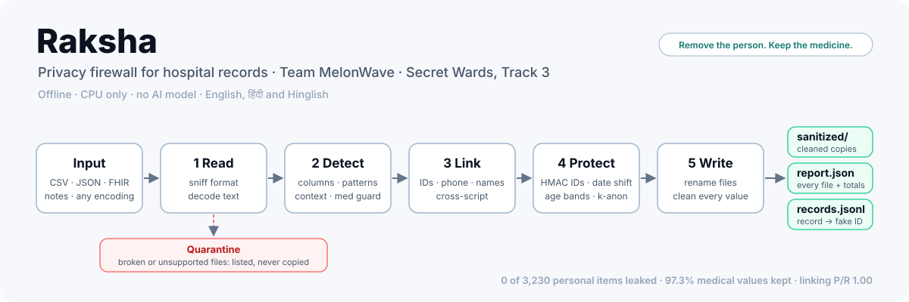

<div align="center">

<picture>
  <source media="(prefers-color-scheme: dark)" srcset="docs/assets/hero-dark.svg">
  
</picture>

# Raksha · Privacy Firewall

**Yugaantar DevForge · Track 3: Secret Wards · Team MelonWave**

*Remove the person. Keep the medicine.*

[**Quick start**](#quick-start) · [How it works](docs/HOW_IT_WORKS.md) · [Results](docs/RESULTS.md) · [Security](docs/SECURITY.md) · [Project brief (PDF)](docs/brief.pdf)

</div>

---

## In one paragraph

Raksha cleans a folder of hospital records so it can be shared for research. It removes
personal data, keeps every medical value, and gives each patient one fake ID across all
files, in English, Hindi and Hinglish. It runs offline, on a normal CPU, with **no AI model**.

**Team MelonWave:** Anusha S · Nandhitha A · Sumanth M · Lokeswar P J

## What's in this repo

| | Path | What it is |
|---|---|---|
| ▶️ | [`main.py`](main.py) | the command-line entry point |
| 🧠 | [`raksha/`](raksha) | the program: `ingest/` (reading), `detect/`, `link/`, `privacy/`, `pseudo/`, `write/`, `security/`, `translit/`, `data/` (name and medical word lists) |
| ⚙️ | [`config/policy.yaml`](config/policy.yaml) | every privacy setting in one file |
| 🧾 | [`raksha.toml`](raksha.toml) | the submission file: team name, setup and run commands |
| 🧪 | [`tests/`](tests) | 70 automatic tests (`pytest -q`) |
| 🎬 | [`samples/`](samples) | 7 demo files, their cleaned output and an 11-point check script |
| 🛠️ | [`tools/`](tools) | development helpers: synthetic data, leak scanner, attack simulator |
| 📚 | [`docs/`](docs) | how it works, results, security design and the 2-page brief |

## Quick start

```bash
pip install -r requirements.txt
RAKSHA_SECRET=any-secret python main.py --input <input folder> --output <output folder>
```

Try it on the included demo (7 small files, 11 automatic checks):

```bash
bash samples/check_samples.sh          # → Result: 11 passed, 0 failed
pip install -r requirements-dev.txt
pytest -q                              # → 70 passed
```

## What it does

| Input | Output |
|---|---|
| `Patient Name: Mohammad Arif   Age/Sex: 47 Yrs/M` | `Patient Name: PSN-WR6SWW   Age/Sex: 40-59 Yrs/M` |
| `नाम: मोहम्मद आरिफ` (Hindi) | `नाम: PSN-WR6SWW` (same patient, same ID) |
| `S/o Yusuf Khan`, `Mobile: +91 98390 11223` | `S/o [RELATIVE]`, `Mobile: [PHONE]` |
| `Date of Admission: 01/03/2026` → `Discharge: 10/03/2026` | `04/04/2026` → `13/04/2026` (shifted, still 9 days) |
| `Dr. Ramesh Srivastava`, `C/O fever x 3 days`, `Ramipril 5 mg 1-0-1` | unchanged |

The output folder contains:

```
output/
├── sanitized/       ← cleaned copies of every file: same folders, columns and formats, UTF-8
├── report.json      ← every input file (by SHA-256), cleaned or set aside, and true totals
└── records.jsonl    ← which fake patient ID each record belongs to
```

## How it works

| | Step | What happens |
|---|---|---|
| 1 | **Read** | format decided from the contents, not the extension; any encoding; broken files quarantined, never copied |
| 2 | **Detect** | columns by header or by their values; patterns for phones, Aadhaar, ABHA, PAN, insurance and hospital IDs; context such as `Name:`, `S/o`, `W/o`, `sahab`, `didi`; a medical guard keeps doctors, doses and diseases |
| 3 | **Link** | blocking, then shared IDs, phone, or name plus a second clue; merges that contradict gender, age or Aadhaar are refused; `मोहम्मद` = `Mohammad` = `Md.` |
| 4 | **Protect** | HMAC fake IDs from the secret; one secret date shift per patient; age bands; addresses removed; districts raised to state when k-anonymity needs it |
| 5 | **Write** | personal data replaced everywhere: values, file names, JSON keys, CSV headers, metadata and attachments |

Details: [docs/HOW_IT_WORKS.md](docs/HOW_IT_WORKS.md).

## Results on the practice data

| | Measure | Result |
|---|---|---|
| 🛡️ | Personal data left in output | **0 of 3,230** items |
| 🐤 | Planted "canary" names leaked | **0 of 4** |
| 💊 | Medical values kept | **97.3%** |
| 🔗 | Patient linking (precision / recall) | **1.00 / 1.00**, no wrong merges |
| 📦 | Valid FHIR bundles | **19 of 19** |
| ⚡ | Run time / memory | **1.3 s / 45 MB** |

On data we did not tune on (every name replaced with invented names, column headers
renamed) it still leaked nothing and linked with precision 1.00 and recall 0.96. The same
secret gives byte-identical output; a different secret gives different IDs and dates.
Details: [docs/RESULTS.md](docs/RESULTS.md).

## Security

* Nothing personal is written to disk except the cleaned output; intermediates stay in memory.
* The secret key is never printed or saved. Separate keys are derived from it for IDs, date
  shifts, file names and encryption.
* Logs show only counts and file hashes, never content. Errors show only the error type.
* Files that cannot be cleaned are listed in the report but never copied.

Details: [docs/SECURITY.md](docs/SECURITY.md).

## Models used

**None.** No AI model of any kind. Detection uses rules and word lists; matching uses string
similarity (`rapidfuzz`).

## Known limitations

* Names that are also English words (Rose, Karma) are only caught when the context gives them away.
* A Hindi name with no label or known spelling elsewhere can be missed.
* XML, PDF and image files are set aside rather than cleaned.
* With few patients, privacy settings are cautious (20-year age bands, state instead of district).

---

<div align="center">

Team **MelonWave** · Anusha S · Nandhitha A · Sumanth M · Lokeswar P J<br>
Built for Yugaantar DevForge, Track 3. All data used is synthetic.

</div>
