# Raksha: an offline privacy firewall for Indian hospital records

**Track 3 · Secret Wards.** Raksha takes a messy export from several hospital systems (CSV, UTF-16 TSV, cp1252 CSV,
nested JSON, FHIR R4 bundles, English / Devanagari / Hinglish notes, broken files) and writes a research release in
which personal data is gone, every clinical value is intact, each real patient carries one stable keyed pseudonym
across files, scripts and hospitals, and the quasi-identifiers are generalised until a voter-list attacker gets
little out of them. It runs offline, on CPU, with no LLM and no trained model at all.

## Quick start

```bash
pip install -r requirements.txt                      # cryptography, rapidfuzz, PyYAML (pinned)
RAKSHA_SECRET=practice python main.py --input ../Secret-Wards-ToolKit/dev/input --output out
python3 ../Secret-Wards-ToolKit/validate_output.py --input ../Secret-Wards-ToolKit/dev/input --output out   # CONTRACT OK
python3 ../Secret-Wards-ToolKit/check_dev.py --output out
pip install -r requirements-dev.txt && pytest -q     # 70 tests
```

`raksha.toml` holds the evaluator's `setup` / `run` commands. `RAKSHA_SECRET` is required: without it the program
exits with code 2 and a generic message. The secret is never printed, logged or written.

Output: `out/sanitized/` (same tree, formats and columns; PII-bearing file names renamed), `out/report.json` (every
input file by SHA-256, status, reason, true counts, timing, peak RSS, chosen privacy settings) and `out/records.jsonl`
(one line per record: `file`, `loc`, `patient`, optional `status`).

## Measured results

All numbers were measured with the kit's tools on this machine (2 CPUs pinned with `taskset`).

| Measure | Practice data | Practice data, every name swapped + headers renamed (`tools/perturb_dev.py`) | Unseen-format synthetic set (`tools/make_synthetic.py`) |
|---|---|---|---|
| PII still visible (`check_dev.py`) | **0 / 3230** (latin 0%, deva 0%, hinglish 0%; all six hiding places 0%) | 0 / 3230 | 0 / 112 strings (leak scan of output, file names, stdout/stderr, TMPDIR) |
| Canaries leaked | 0 / 4 | 0 / 4 | 0 / 3 |
| Medical values kept | 97.3% (4723 / 4855) | 97.3% | 5 / 5 probes |
| Linking precision / recall / F0.5 | **1.00 / 1.00 / 1.00**, 0 false merges | 1.00 / 0.96 / 0.99, 0 false merges | 48 / 48 pairs, 0 false merges |
| Run time / peak RSS | 1.25 s / 45 MB | 1.3 s / 45 MB | < 1 s |
| 10× practice data (2,000 files) | 14 s / 145 MB (growth exponent about 1.0) | | |

Generalisation, honestly. The first run on the perturbed data, before any fix, leaked 28 / 3230 (0.9%: single
unseen first names before Hinglish particles, names used as JSON keys, an ID header renamed to `Hospital Reg ID`) and
linked at P 0.98 / R 0.68 with 4 false merges. The fixes were generic rules (a broader ID-header grammar,
shape-based names in JSON keys, and strong identifiers linking despite spelling drift in names). A fresh perturbation
seed and a fresh synthetic seed, never inspected before measuring, also came out at 0 leaks and 0 false merges.

The 2.7% of medical probes that are not kept are deliberate: 92 district probes (the district is generalised to
state, see below), 12 diagnosis/procedure probes of patient-unique conditions (generalised to ICD-10 chapter) and
6 ward names in a clean census.

Other checks: 19/19 output FHIR bundles validate with `fhir.resources` (R4B) and every reference resolves; all
774 pseudonym claims appear inside their exported record; 0 of 1,113 true clinical dates survive in their own record;
every patient's dates move by one shift across all of their files, so lengths of stay and intervals are exact;
the same secret gives byte-identical output and a different secret changes every pseudonym and shift; the run works
inside an empty network namespace (`unshare -rn`); the input folder is opened read-only and never modified.

## Architecture

```mermaid
flowchart LR
  A[input folder, read-only] --> B[ingest: sniff format, decode<br/>UTF-8/BOM/UTF-16/cp1252, quarantine]
  B --> C[learn: ID shapes from<br/>ID-labelled fields]
  C --> D[detect: column classifier +<br/>free-text detector + medical guard]
  D --> E[identity evidence<br/>per record]
  E --> F[link: blocking, Fellegi-Sunter,<br/>conflict-aware clustering]
  F --> G[pseudonyms HMAC + per-patient<br/>date shift + age band]
  G --> H[privacy: k-anonymity search,<br/>location level, rare values]
  H --> I[render pass 2: re-detect with<br/>cluster-wide names]
  I --> J[sanitized/ + records.jsonl + report.json]
```



```
raksha/
  ingest/    detect_format (content sniffing, depth bombs) · encodings · csv_reader · json_reader · fhir_reader
  detect/    normalize (homoglyphs, zero-width, \u / HTML / %-escapes, Devanagari digits) · patterns (IDs, phones…)
             context_rules (labels EN/HI/Hinglish, S/o-W/o-D/o, honorifics, address grammar) · names (gazetteer,
             shape, grabbing) · medical_guard (meaning traps) · column_classifier · combine · text_detector
  translit/  devanagari (schwa-aware transliteration) · canonical (cross-script name keys, phonetic skeletons)
  link/      extract_identity · compare · cluster (blocking + scoring + conflict-aware agglomeration)
  pseudo/    hmac_ids (keyed Crockford base32, collision-free)
  privacy/   dates (format-preserving shift) · age_band · location · risk (k-anonymity search) · rare_values
  write/     render · filename_sanitizer
  security/  crypto (HKDF key separation, AES-GCM vault) · safe_log (allow-list) · quarantine · tempdir
  data/      gazetteers: Indian given names and surnames, generic name parts, UP districts (+ Devanagari),
             medical lexicon (drugs, labs, conditions, eponym heads, org words), English word list (SCOWL)
tools/       make_synthetic · leak_scan · perturb_dev · attack_sim · check_temporal · check_structure
```

## How each part works

**Ingestion.** Every file is classified by its bytes, not its extension: magic numbers (PDF, JPEG, PNG, ZIP…) and
markup (XML/CDA) are quarantined; BOMs, BOM-less UTF-16 and cp1252 are decoded; JSON is detected by content (a
`.csv` holding JSON is processed as JSON; a `.txt` starting with `[` falls back to text). JSON nesting is measured
iteratively and anything deeper than `limits.max_json_depth` is quarantined (no recursion bombs). Truncated JSON,
empty and binary files are quarantined with a reason code. Nothing is ever copied to `sanitized/` raw, and every
input file appears in `report.json`.

**Detection: structured fields.** Each CSV column and JSON key path is classified (patient name, name part, relative,
phone, UHID/MRN/IPD, Aadhaar, ABHA, PAN, insurance, address, village, tehsil, district, PIN, DOB, age, age/sex,
gender, date, doctor, free text) from header semantics in English, Hinglish and Hindi (`Naam`, `Pita/Pati ka Naam`,
`Janm Tithi`, `मोबाइल`, `Patient's Name`, `Contact#`, `Gram/Mohalla`…) together with its parent keys
(`facility.name` is not a person, `raised_by.name` is a non-patient person). When the header is unseen or garbage,
value statistics decide (phone / Aadhaar / ABHA / PAN / email patterns, `65/F`, dates whose years spread like birth
dates, `S/o …`, name-shaped values). Identifier formats are learned at run time from ID-labelled fields
(`SNJ/99/999999`, `IPD-9999-99999`…), never hard-coded, and then found anywhere: in notes, file names, CSV headers,
JSON keys and FHIR `meta.source`.

**Detection: free text, three scripts.** Spans come from (1) validated patterns: Indian mobiles in every grouping and
prefix, landlines, Aadhaar and masked Aadhaar, ABHA number and address, PAN, insurance and PMJAY IDs, email;
(2) labels such as `Patient Name:`, `नाम:`, `मरीज़ का नाम:`, `पिता का नाम:`, `Attendant:`, `UHID:`, `पंजीकरण सं.:`,
`Mob.`, `Address:`, `R/o`, `ग्राम:`; (3) relation markers (`S/o`, `W/o`, `D/o`, `C/o`, `पुत्र`, `पत्नी`). The name
after a marker is a relative, and the name before `W/o` is the patient (`Asha, W/o Kamal`); (4) honorifics, both
suffix (`ji`, `sahab`, `behenji`, `didi`, `जी`) and prefix (`Shri`, `Smt.`, `श्री`), removed together with the name;
(5) a gazetteer of Indian given names and surnames, reached from Devanagari through a schwa-aware transliterator and
canonical keys (Mohammad / Mohd / Md. / मोहम्मद → one key; Reena / Rina / रीना → one key); (6) a shape rule for names
nobody listed: runs of capitalised tokens that are not English, medical or place vocabulary. The canaries are caught
by context and shape, not by a list; (7) propagation: every other mention of a name already known for that patient
anywhere in the cluster is removed too (`Shahid sahab` → `Mohd. Shahid` → `Shahid`).

**Meaning traps (medical guard).** Protected spans veto name and address detections: `Dr. X` and `डॉ. X` (clinicians
are kept), `C/O` / `H/O` followed by a complaint (`C/O fever`, `H/O TB`, `No H/O DM/HTN`) as opposed to a person
(`C/O Ramesh Patel`), `K/C/O`, drug + strength (`Dolo 650`, `Ramipril 5 mg`), frequencies (`1-0-1`, `BD`, `x 5 days`),
vitals and labs with units, ICD codes, eponyms (`Addison's disease`, `Parkinson's`, `Bell's palsy`), hospital wards
(`Ward 4 (Medicine)`; a ward inside an address is a locality and is removed), organisation names, and `ASHA worker`.

**Linkage.** Each record yields identity evidence: canonical names in both scripts, IDs, phones, relatives, gender (from
fields, `/F`, `महिला`, relation markers, honorifics), ages anchored to the record's own date (so birth-year estimates
compare across years), DOB, village and district. Clustering is agglomerative and conflict-aware, never a naive
transitive closure. (1) A shared UHID / IPD / Aadhaar / ABHA / PAN / insurance ID merges; a shared phone merges only
when the names are compatible, because families share phones. (2) Same full name across scripts (Jaro-Winkler and
skeleton match on canonical tokens) plus a corroborating clue (DOB, relative, or village + age ±1), scored with
Fellegi–Sunter weights from `policy.yaml`, merges only when the candidate is unique. (3) Fragments such as
`Meera, W/o Rajan` join only a unique match on first name + relative. Every merge is vetoed by hard conflicts:
gender, birth year more than 2 years apart, DOB, different Aadhaar or ABHA numbers. Same name with no corroboration
is never linked, so the homonym pairs stay apart. A record with weak evidence only gets `patient: null`.

**Pseudonyms.** `PSN-` + 6 Crockford base32 characters of HMAC-SHA256 over the cluster's canonical key (the smallest
of its identifiers, so file order does not matter), keyed with an HKDF sub-key of `RAKSHA_SECRET`. Collisions extend
every colliding code. The pseudonym replaces the patient's name or ID inside the record (`Patient Name:`, `UHID`,
`patient_ref`, FHIR identifier), so every claim in `records.jsonl` is visible in the data.

**Privacy layer.**
* **Dates:** one secret shift per patient (HMAC of the cluster key, ±15–180 days, never 0) applied to every date of
  that patient in every file and format (ISO, d/m/y, m/d/y, dd.mm.yyyy, `5 September`, Hindi months, WhatsApp
  stamps, FHIR instants). Lengths of stay and intervals are exact; there is no global offset for attack A5 to
  recover. Day/month order per file is learned from unambiguous dates and propagated through the most specific
  source key (ID format, then document header, then file prefix), so Arogya's month-first exports shift correctly.
  DOB is shifted with the patient (DOB score "shifted ≤ 1 year").
* **Age:** one truthful band per patient covering all of their observed ages (aligned on multiples of the width;
  ages straddling a boundary get a half-step band); 80+ is top-coded.
* **Location:** house, locality, landmark, village and tehsil are always removed. District is kept or lifted to state
  by the k-anonymity search; at state level, district names in hospital headers and organisation addresses follow as
  well. PIN keeps 3 digits at district level and is removed at state level.
* **k-anonymity search** (`privacy/risk.py`): over (gender, age band, location) classes of patients, try widths
  5 → 10 → 20 and levels district → state; take the first setting with at most 10% of patients below k = 5. On the
  practice data it picks **20-year bands at state level** (k-min 1, 37.5% of patients below k at the widest
  setting, reported in `report.json`).
* **Rare values:** a diagnosis or procedure held by a single patient (rabies, kala-azar, Whipple procedure…) is
  generalised to its ICD-10 chapter (`A00-B99`, "Certain infectious and parasitic diseases") or to
  `[RARE PROCEDURE]` in that patient's records only (19 records on the practice data). LOS, vitals, labs and doses are
  never altered.

**Hidden places.** File names (PII components are renamed to vocabulary words + a keyed tag, mapping declared in
`report.json`), CSV headers, JSON keys, `_export_meta.source_path`, FHIR `meta.source`, narrative `text.div`
(rendered without breaking XHTML), extensions (`mothers-name`), base64 attachments (decoded, sanitised, re-encoded;
binary attachments are replaced), and FHIR resource ids that hold PII (remapped consistently across `id`,
`fullUrl` and `reference`).

## Privacy–utility trade-off

| Choice | Privacy effect (measured on practice data) | Utility cost |
|---|---|---|
| District → state (k-anonymity) | profile re-identification in our A4 simulation: 42% of patients (district + 10-year bands) → 0% | district probes (92 of 4855, weight 0.3); location sub-score 0.7 → about 0 |
| 20-year age bands (k-anonymity) | registry candidates per (gender, band) cell: mean 1/k 0.083 (10-year) → 0.042 (20-year) | age sub-score 0.8 → 0.6 (still truthful) |
| Per-patient secret date shift | A5 cannot recover a global shift; a known visit date never matches | none: intervals and LOS exact |
| Patient-unique diagnoses → ICD chapter | removes the ×8 rare-condition signal for the re-identification traps | 12 probes in 19 records |
| District names in headers / org addresses → state | removes a district signal the attacker would read from `HOSPITAL, LUCKNOW` | none (hospital probes do not include the city) |

Re-identification risk, measured with `tools/attack_sim.py`, an approximation of the published A2–A4 attacks run
against the practice registry. It is weaker than the official attacker (its raw linkage risk is 0.60 against the
kit's 0.92), so use it for comparisons. Record linkage falls to **0.033 of raw** and profile re-identification to
**0 of 48 patients** (raw: 48 of 48). Within the release, 2 of 48 patients (4%) are unique on (gender, age band,
location). Everyone is unique on (age band, location, admission week, diagnosis), but the week is computed on
secretly shifted dates, so it cannot be matched against a known true visit date.

## Security design

* **No intermediates on disk.** All parsing, detection and linkage state stays in process memory. `security/crypto.py`
  provides an AES-256-GCM vault (random 96-bit nonce, file id as associated data) for any spill
  (`security.spill_to_disk` in policy, off by default), and `security/tempdir.py` creates a 0700 directory under
  `TMPDIR` that is wiped in `finally`. The leak scan confirms 0 files are left in `TMPDIR`/`HOME`.
* **Key separation.** `RAKSHA_SECRET` is expanded with HKDF-SHA256 into independent sub-keys for pseudonyms, date
  shifts, file/key tags and the vault, so one derived value never reveals another and the secret itself is used once.
  It is never printed, logged, or written (checked by `check_submission.py` and by a test).
* **PII-free logging.** `security/safe_log.py` only emits fixed templates whose arguments must be numbers, hex digests
  or code tokens, so a stray name is replaced by `?`. Per-file failures log `file sha256[:12] + stage + exception
  class` and quarantine the file. A global `sys.excepthook` prints only the exception class, and a test fails the
  build if `print(` or `traceback` appears in the package.
* **Quarantine.** Files that cannot be processed safely are listed by hash with a reason code and are never copied
  (not even to `output/quarantine/`).
* **Production design (what we would add with real data).** Envelope encryption: each export is encrypted with a
  per-dataset data key (AES-GCM), and that key is wrapped by a KMS/HSM key-encryption key the pipeline host never sees in
  clear. Keys are kept away from data: the release secret lives in the KMS and is injected at run time only, pseudonym and
  shift keys rotate per release (unlinkable releases), and audit logs record hashes and counts only. Assume breach: the
  host holds only wrapped keys and ciphertext at rest, and sanitised outputs carry no reversible tokens.

## Declared models

None. No LLM, no generative model, no transformer, no trained classifier. Detection is rules + gazetteers +
transliteration; linkage uses Jaro–Winkler (`rapidfuzz`) and hand-set Fellegi–Sunter weights. Data files shipped in
`raksha/data/`: our own lists of Indian given names / surnames / generic name parts / UP districts / a medical
lexicon, and an English word list derived from the public-domain SCOWL `american-english` dictionary. No practice
names, canaries or file names are embedded.

## Configuration

`config/policy.yaml` (documented inline): pseudonym length; date-shift range and default day/month order; age band
floor and top code; location levels and PIN digits per level; k-anonymity target, allowed violation share and
widening order; rare-value threshold; linkage weights and thresholds; JSON depth and file-size limits.

## Known limitations

* The k-anonymity search runs over the patients in the release, not the attacker's population, so on a small release
  it generalises aggressively (20-year bands, state level). On larger hidden datasets it can settle on narrower
  bands.
* Names that are both common English words and Indian names (Karma, Rose, Prem) are found only through context
  (labels, honorifics, relation markers, propagation), not by the shape rule.
* A Devanagari name with no label, honorific, gazetteer hit or known spelling elsewhere in the cluster can be missed.
* Day/month order for a file with only ambiguous dates is inferred from other files of the same source. A source
  whose files are all ambiguous falls back to day-first.
* Records with only weak evidence (a first name and nothing else) stay unlinked (`patient: null`) by design.
* XML / HL7 CDA, PDF and images are quarantined rather than sanitised. Binary FHIR attachments are replaced, not
  OCR-sanitised.
* `tools/attack_sim.py` is an approximation of the published attacks, not the official attacker.

## Repository map

`main.py` CLI · `raksha/` package · `config/policy.yaml` · `tests/` (70 tests: traps, linkage, privacy, security,
end-to-end determinism and leak checks) · `tools/` (generalisation and evaluation tools, dev only) · `NOTES_DATA.md`
(what the practice kit contains, and where the kit and the build prompt differ) · `PROGRESS.md` (milestone table) ·
`BRIEF_DRAFT.md` / `docs/brief.pdf` (2-page project brief).
